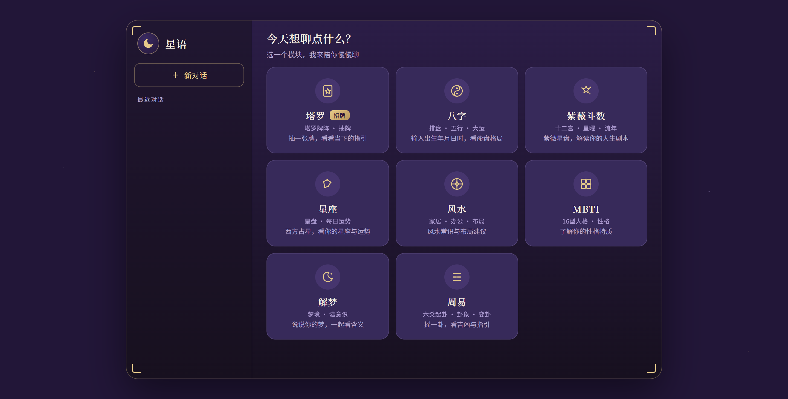

# 星语 · 命理助手

> 温柔、亲切的「星语」陪你聊八字、紫微斗数、星座、风水、MBTI、解梦与塔罗。🌙

一个基于 **LLM Agent + RAG** 的命理问答机器人：前端 React + Vite，后端 FastAPI + LangChain，支持流式输出、多轮对话、会话历史与本地知识库检索。

---

## ✨ 功能特性

- **7 个命理模块**：八字排盘、紫微斗数、星座运势、风水、MBTI 性格、周公解梦、塔罗占卜、周易六爻
- **流式输出（SSE）**：打字机式回复，实时显示「正在为你排八字…」等工具执行状态
- **Agent 工具调用**：命理接口、联网搜索、本地知识库检索自动编排
- **本地知识库（RAG）**：ChromaDB + 本地 Ollama bge-m3 embedding，检索风水常识与塔罗牌义
- **多轮对话 + 会话历史**：Redis 存储，刷新后可从「最近对话」继续
- **Markdown 渲染**：AI 回复支持加粗、列表、代码块、表格等格式
- **深色神秘学主题 UI**：塔罗卡牌风界面，响应式布局（含移动端侧栏）




### 各模块数据来源一览

| 模块 | 数据来源 | 说明 |
| --- | --- | --- |
| 🃏 **塔罗占卜** | **本地随机抽牌** + 本地知识库 | Python 随机抽 3 张牌（过去·现在·未来），牌义从本地 ChromaDB 检索 |
| 📖 **塔罗知识** | **本地知识库**（ChromaDB） | 检索 78 张牌的牌义、正逆位、关键词、占星/元素对应等 |
| 🀄 **八字** | [缘份居 API](https://api.yuanfenju.com/index.php/v1/Bazi/cesuan) | 排八字命盘、大运，由 DeepSeek LLM 解读 |
| 🔮 **紫微斗数** | [缘份居 API](https://api.yuanfenju.com/index.php/v1/Bazi/zwpan) | 起紫微星盘，由 DeepSeek LLM 解读十二宫与星曜 |
| ✨ **星座运势** | [缘份居 API](https://api.yuanfenju.com/index.php/v1/Zhanbu/yunshi) | 查询 12 星座当日/近期运势，由 DeepSeek LLM 解读 |
| 🌙 **周公解梦** | [缘份居 API](https://api.yuanfenju.com/index.php/v1/Gongju/zhougong) | 用 LLM 提取梦境关键词 → 缘份居查询 → 直接返回解梦文本 |
| 🏠 **风水** | **本地知识库**（ChromaDB） | 向量检索风向常识与布局建议 → DeepSeek LLM 组织回答 |
| ☯️ **周易六爻** | **本地算法** + 本地卦辞文件 | `resources/zhouyi/Gua.txt` 和 `GuaName.json`，Python 摇卦算法 + 本地查卦 |
| 🧠 **MBTI** | LLM 对话 + 联网搜索 | 纯 LLM 引导式提问分析，无外部 API |
| 🔍 **联网搜索** | [SerpAPI](https://serpapi.com/) | 以上所有模块共用，当本地/API 知识不足时自动触发 |

> 💡 缘份居是第三方命理数据服务，**八字、紫微、星座运势、解梦** 四个模块依赖它。如果 `YUANFENJU_API_KEY` 未配置或余额不足，对应模块会返回"服务暂时不可用"。
>
> 💡 **风水、塔罗、周易** 三个模块完全离线运行，不依赖任何外部 API，数据来自本地文件和向量数据库。

## 🛠 技术栈

| 层 | 技术 |
| --- | --- |
| 前端 | React 18 · Vite 6 · 原生 CSS |
| 后端 | Python 3.11 · FastAPI · LangChain · LangGraph |
| 模型 | DeepSeek（对话） · 本地 Ollama bge-m3（embedding） |
| 存储 | Redis（会话历史） · ChromaDB（本地知识库） |
| 外部 API | 缘份居（命理） · SerpAPI（联网搜索） |

## 📁 目录结构

```text
agent_numerology/
├── server.py                 # FastAPI 后端主入口（含 SSE 流式接口）
├── models.py                 # 大模型客户端 / embedding 配置
├── mytools.py                # Agent 工具（八字、紫微、星座、塔罗、解梦、搜索等）
├── logger.py                 # loguru 日志配置
├── insert_data_to_chroma.py  # 初始化本地风水知识库
├── insert_tarot_to_chroma.py # 初始化塔罗知识库（78 张牌义）
├── chroma_db/                # 本地向量库数据
├── frontend/                 # React + Vite 前端（推荐）
│   ├── src/                  # 前端源码
│   ├── public/               # 静态资源
│   └── vite.config.js        # 开发代理配置
├── ui-preview.html           # 独立 UI 预览页
├── 交互范例文本.md            # 示例对话
├── Dockerfile / docker-compose.yml
├── requirements.txt
└── .env.example              # 环境变量模板（复制为 .env 后填写）
```

## 🚀 快速开始

### 1. 准备环境

- Python **3.11**（建议）
- Ollama **必需（本地知识库）**：安装后运行 `ollama pull bge-m3`
- Node.js **18+**（前端构建/开发需要）
- Redis **可选**：不启动也能用，只是「最近对话」历史不持久化

### 2. 配置环境变量

```bash
cp .env.example .env   # Windows: copy .env.example .env
```

编辑 `.env`，填入各服务的 API Key：

| 变量 | 说明 | 必填 |
| --- | --- | --- |
| `DEEPSEEK_API_KEY` | DeepSeek 对话模型 | ✅ 是 |
| `SERPAPI_API_KEY` | SerpAPI 联网搜索 | 可选 |
| `YUANFENJU_API_KEY` | 缘份居命理接口（八字/紫微/星座/解梦） | 相应模块需要 |
| `REDIS_URL` | Redis 地址，默认 `redis://127.0.0.1:6379/6` | 可选 |

> ⚠️ **`.env` 含有真实密钥，务必不要提交到 Git。** 仓库已提供 `.gitignore` 排除它。

### 3. 安装依赖并启动

**后端：**

```bash
python -m venv venv
# Windows
venv\Scripts\activate
# macOS / Linux
source venv/bin/activate

pip install -r requirements.txt
python server.py
```

后端默认运行在 <http://127.0.0.1:8000/>。

**前端（二选一）：**

- 生产模式：构建后由后端直接托管

  ```bash
  cd frontend
  npm install
  npm run build
  ```

  重新访问 <http://127.0.0.1:8000/> 即可看到界面。

- 开发模式：热更新调试 UI

  ```bash
  cd frontend
  npm install
  npm run dev
  ```

  前端运行在 <http://127.0.0.1:5173/>，已配置代理把 `/chat`、`/sessions` 转发到后端 8000 端口。

## 🔌 主要 API

| 方法 | 路径 | 说明 |
| --- | --- | --- |
| `GET` | `/` | 前端页面 |
| `POST` | `/chat/stream` | 对话流式接口（SSE），`query` / `session_id` / `module` |
| `GET` | `/sessions` | 会话列表 |
| `GET` | `/sessions/{id}/messages` | 某会话的历史消息 |

交互式 API 文档见 <http://127.0.0.1:8000/docs>。

## 🐳 Docker 部署

项目已配置好 `docker-compose.yml`，一键启动应用 + Redis + Ollama 三个服务，无需手动安装任何依赖。

### 前置要求

- 已安装 [Docker](https://docs.docker.com/engine/install/ubuntu/) 和 Docker Compose（`docker compose` 插件已内置在 Docker 中）
- 在项目根目录创建 `.env` 文件，填入 API Key（参考上方「配置环境变量」一节）

### 一行启动全部服务

```bash
docker compose -p numerology up --build
```

这会在后台启动三个容器：

| 容器 | 说明 | 端口映射 |
| --- | --- | --- |
| `numerology` | 应用本体（FastAPI + 前端） | `8001:8000` |
| `redis` | 会话历史缓存 | `6380:6379` |
| `ollama` | 本地嵌入模型 bge-m3 | `11434:11434` |

首次启动时 Ollama 容器会自动下载 `bge-m3` 模型（约 1-2 GB），模型数据存储在命名卷 `ollama_data` 中，后续重启无需重新下载。

### 访问应用

打开浏览器访问 **`http://<Ubuntu服务器IP>:8001`**。

### 初始化知识库（首次部署需要）

知识库用于风水模块和塔罗模块的本地检索。Ollama 容器启动后，在其中执行初始化脚本：

```bash
# 初始化风水知识库
docker compose -p numerology exec -it numerology python insert_data_to_chroma.py

# 初始化塔罗知识库（78 张牌义）
docker compose -p numerology exec -it numerology python insert_tarot_to_chroma.py
```

### 常用命令

```bash
docker compose -p numerology up -d          # 启动全部服务（后台）
docker compose -p numerology logs -f        # 实时查看日志
docker compose -p numerology restart        # 重启全部服务
docker compose -p numerology down           # 停止并删除容器
docker compose -p numerology down -v        # 停止并删除容器+卷（清空模型数据）
docker compose -p numerology up -d --build  # 重新构建镜像并启动（代码有改动时）
```

## ❓ 常见问题

- **「排盘失败 / 请求失败」**：多为缘份居接口返回权限/会员/积分不足。缘份居是第三方命理服务，部分接口需开通会员或购买次数，报错信息会透传到对话里。
- **模型调用报错**：`models.py` 中配置的模型为 `deepseek-v4-pro`，如 DeepSeek 侧报「模型不存在」，请改成官方公开型号（如 `deepseek-chat`、`deepseek-reasoner`）。
- **没有 Redis 报错吗？**：所有 Redis 读写都已做容错处理并设置 1 秒超时，未启动 Redis 时服务照常运行，仅会话历史不持久化。
- **风水模块查不到内容**：先运行 `python insert_data_to_chroma.py` 初始化本地向量库（需本地 Ollama 已运行并已 `ollama pull bge-m3`）。
- **塔罗模块查不到牌义**：先运行 `python insert_tarot_to_chroma.py` 初始化塔罗知识库（需本地 Ollama 已运行并已 `ollama pull bge-m3`）。

## TODO
- 移动端布局适配，字体有些大
- 导入《周公解梦》，将解梦模块改成本地知识库查询+LLM 生成方式
- 首页布局垂直居中，但是一到具体的模块对话页面，位置会有点向上偏移。首页模块卡片的字体层级不太清晰
- 对话记录日期时间需要记录
- 页面左右两侧有些空，如果加上可以符合主题的插画，效果应该会更好些。在切换到不同模块进行对fangm话时，插画需要有个自然的过渡效果
- 全局的对话字体样式改成可爱的手写体，应该会更有温度些，默认的方块字体给人一种有距离的感觉，但选择手写字体时，需要考虑易读性
- 上下文的处理，用户信息的持久化
- 塔罗：如果在项目中存放所有的塔罗牌图片就好了，有对应卡牌名和卡牌图片，在识别到用户抽卡指令后llm返回答案前，先显示三张塔罗牌，再当用户点击牌翻面后显示含义，这种交互效果会更好些，实现应该会有些难度。（llm要按固定的结构返回，如果观察到结果不对，要继续重新生成，ReAct模式）
  （应该还会有些功能，等想到我再继续补充叭~~）

## 📄 License
MIT License
